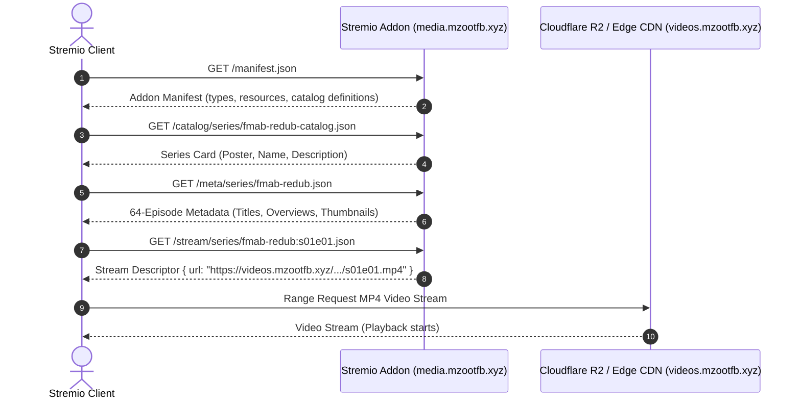

# FMAB Redub Stremio Addon

> Lightweight Stremio media addon serving catalog, metadata, and stream resolution for the Fullmetal Alchemist: Brotherhood redub archive.

[](https://stremio.com)
[](https://nodejs.org)
[](#verification--testing)
[](LICENSE)

`stremio-addon` is a specialized, zero-database media addon compliant with the official Stremio Addon Protocol. It exposes catalog listings, series metadata, episode overviews, and direct HTTP video stream resolution pointing to Cloudflare R2 object storage.

---

## Architecture & Integration Flow

The addon acts as a metadata and manifest provider. It does not ingest or transcode video files itself; rather, it resolves playback requests to edge-distributed object storage:



---

## Addon Endpoints & Sample Responses

### 1. Addon Manifest
`GET /manifest.json`

```json
{
  "id": "xyz.mzootfb.fmab-redub",
  "version": "1.0.0",
  "name": "FMAB Redub Catalog",
  "description": "Spanish redub edition of Fullmetal Alchemist: Brotherhood",
  "resources": ["catalog", "meta", "stream"],
  "types": ["series"],
  "catalogs": [
    {
      "type": "series",
      "id": "fmab-redub-catalog",
      "name": "FMAB Redub"
    }
  ]
}
```

### 2. Stream Resolution
`GET /stream/series/fmab-redub:s01e01.json`

```json
{
  "streams": [
    {
      "title": "FMAB Redub - 1080p MP4",
      "url": "https://videos.mzootfb.xyz/el-alquimista-de-acero/season-01/s01e01.mp4"
    }
  ]
}
```

---

## Installation & Local Development

### Prerequisites

- Node.js 18+

### 1. Install Dependencies

```sh
git clone https://github.com/jsalg-byte/stremio-addon.git
cd stremio-addon

npm install
```

### 2. Configure Environment

Create a `.env` file or export environment variables:

| Variable | Default | Description |
| :--- | :--- | :--- |
| `PORT` | `7000` | HTTP listening port for the addon server |
| `MEDIA_BASE_URL` | `https://videos.mzootfb.xyz` | Base CDN/R2 URL for video assets |
| `ADDON_PUBLIC_URL` | `https://media.mzootfb.xyz` | Public URL where this addon is hosted |

### 3. Start Local Server

```sh
npm start
```

Validate locally in another terminal:
```sh
curl http://localhost:7000/manifest.json
curl http://localhost:7000/meta/series/fmab-redub.json
curl http://localhost:7000/stream/series/fmab-redub:s01e01.json
```

---

## Verification & Testing

The repository includes a comprehensive assertion suite verifying the manifest schema, all 64 episode IDs, episode metadata fields, thumbnail file sizes (enforced `<5KB` for rapid Stremio client rendering), and stream URL format:

```sh
npm run validate
```

---

## Production Deployment (Coolify / Nixpacks)

The service is configured for zero-overhead deployment using Nixpacks or Docker:

- **Buildpack**: Nixpacks / Node
- **Start Command**: `npm start`
- **Exposed Port**: `7000`
- **Install in Stremio**:
  - Web Manifest: `https://media.mzootfb.xyz/manifest.json`
  - Stremio Deep Link: `stremio://media.mzootfb.xyz/manifest.json`

---

## Scope & Limitations

- **Media Hosting**: Video MP4 files are hosted independently in Cloudflare R2. This service only responds with redirect stream descriptors.
- **Single Series Scope**: Version 1 explicitly catalogs the complete 64-episode run of Fullmetal Alchemist: Brotherhood Spanish redub.
- **Client Requirements**: Requires Stremio Desktop, Mobile, or Web with support for direct HTTPS MP4 streams.

---

## License

This project is licensed under the MIT License. See [LICENSE](LICENSE) for details.
